# Guaranteed to hit the right zone! 13 innovative enhancements! Improving the snow melting algorithm GVSAO for multimodal fault identification through 1D-2D-GASF-CNN-GRU-MSA image fusion.

Applicable Platform: MATLAB 2023 and above
Multimodal Fault Identification Model for Time-Series Fusion of Multi-Channel Images Based on Improved Snow Melt Algorithm GVSAO Optimized 1D-2D-GASF-CNN-GRU-MSA
References:
1. Chinese EI journal "Power Automation Equipment" online first document: "Health Diagnosis of Switching Devices in Grid Inverters Based on Gram Angle Field and Parallel CNN"
2. Published in June 2023 in the top-tier SCI journal "Expert Systems With Applications" by the Chinese Academy of Sciences. This algorithm has just been proposed, and there are no existing literature applying this algorithm yet!
The aforementioned two papers are recent publications in top-tier journals. We will combine these two papers and make multiple improvements to propose a multimodal fault identification model based on an improved snow melt algorithm GVSAO optimized 1D-2D-GASF-CNN-GRU-MSA for time-series fusion of multi-channel images. With thirteen innovations, it can fully support a high-level academic paper. Below is a detailed introduction.
Reference interpretation one: In this paper, firstly, the time-series sequences of one-dimensional fault voltage and current signals are collected; secondly, they are transformed using the Gram angle field, converting the two one-dimensional time-series signals into the Gram angle field; finally, the generated two sets of images are simultaneously fed into the CNN for parallel learning and training, achieving fault diagnosis of the inverter. The principle of the Gram angle field can be referred to in previous tweets, which we will not elaborate here.
Reference interpretation two: This paper introduces a novel metaheuristic algorithm named Snow Ablation Optimizer (SAO), used for numerical optimization and engineering design. The SAO algorithm mainly simulates the melting and sublimation behaviors of snow, achieving a balance between development and exploration in the solution space, and avoiding premature convergence.
1. Validation of the product through the use of 29 typical CEC2017 unconstrained benchmark problems and 22 real-constraint optimization problems, as well as traditional AO, MVO, EO, AVOA, HHO, PSO-sono, SHADE, LSHADE-SPACMA, verifying the optimization capability of SAO. Additionally, to further validate its advantages, the author applied SAO to extract core parameters of photovoltaic systems. The results show that the developed SAO performs better than other advanced optimization methods.
2. Multimodal Fault Identification Model for Time-series Fusion of Multichannel Images Based on Improved Glaser Algorithm GVSAO Optimization
3. Model improvement based on literature one: Our proposed model makes multiple improvements on the above model: adopting a dual-branch structure, only requiring raw fault waveform data to transform a one-dimensional sequence into two-dimensional Gram angle field images. One branch is for image input through CNN to extract Gram angle field image features, and the other is for direct fault waveform input through GRU to extract time-series features. High-dimensional image features and one-dimensional time-series features are fused. The multihead attention mechanism (MSA) effectively grasps the contribution degree of extracted features, strengthens them, improves fault identification accuracy, and calculates evaluation indicators such as precision, recall, accuracy, F1 score, etc. This part of the fault identification model is as follows:
4. Improvement of the Glaser algorithm GVSAO based on literature two:
5. Improvement point one: The set of good points was proposed by Chinese mathematician Hua Luogeng and others, its principle is to uniformly distribute initial search individuals, which can increase the diversity of the population during the initialization process, benefiting from the escape from local optima.
Improvement point two: The traditional improvement strategies used in a large number of literatures, such as chaotic mapping, Cauchy mutation, Gaussian mutation, random walk, differential mutation, reverse learning, Levy flight, etc. However, these strategies have been overused and become commonplace, making it difficult to produce novel effects, resulting in the article lacking uniqueness. The periodic oscillation mutation strategy adopted in this paper is quite rare, and it significantly improves the model's convergence speed without increasing computational burden, injecting high innovation into the article.
The innovation of GVSAO algorithm mainly lies in the following six aspects:
Optimal Initialization Strategy: During the initialization process, the population is uniformly distributed, which can increase the diversity of the population and facilitate the escape from local optima.
Double Population Mechanism: The SAO algorithm introduces a double population mechanism, dividing the population into two subpopulations to explore and exploit, thereby achieving balance in the solution space.
Brownian Motion Exploration Strategy: During the exploration phase, the algorithm employs Brownian motion to simulate the irregular movement of steam, endowing search agents with a highly dispersed characteristic, thereby exploring potential regions.
Day-of-year method utilization strategy: During the exploitation phase, SAO employs the day-of-year method to simulate snowmelt processes, encouraging search agents to find high-quality solutions near their current best solution.
Overall Position Update Equation: The SAO algorithm employs an overall position update equation that integrates exploration and exploitation strategies, as well as population dynamics, to optimize the positions of each individual.
Periodic oscillation mutation strategy: The purpose of designing this mutation strategy is to capture the major trend of convergence, escape from local traps, and obtain the correct search pattern.
The improved model combining the above two documents: The GVSAO (Gated Recurrent Unit with Sparse Attention) algorithm is used to optimize learning rates, CNN image feature extraction convolution kernel sizes, and the number of neurons in GRU temporal feature extraction branches for multimodal models. This optimization ensures a more rational model architecture, accelerates convergence speed, and improves fault identification accuracy. The structure of the multimodal fault recognition model optimized by the 1D-2D-GASF-CNN-GRU-MSA multichannel image temporal fusion based on the improved GVSAO is shown in the figure below.
Seven innovations in the multimodal model:
1. Multimodal Fusion: Integrating one-dimensional time series signals and two-dimensional images allows for the comprehensive use of information from different modalities, thereby more comprehensively describing data characteristics. This helps to extract richer and more distinctive features, thereby improving classification and recognition accuracy.
2. Time Series Information Acquisition: GRU (Gated Recurrent Unit) is a type of recurrent neural network suitable for time series data. It can capture dynamic changes and trends in one-dimensional time series signals. By integrating GRU with CNN, the algorithm can consider both time series features and spatial features simultaneously, further enhancing its performance.
3. Spatial Feature Learning: CNN (Convolutional Neural Network) performs excellently in image processing, effectively learning spatial features and local patterns of images. Applying CNN to image data processing helps to extract texture, shape, and edge features of images, aiding in more accurate classification and fault identification.
4. Fusion Advantage: By fusing information from different modalities, the algorithm can compensate for the limitations of one-dimensional time series signals and two-dimensional images. For example, images may be more sensitive to certain fault modes, while time series signals may be more sensitive to other modes. Combining them together can enhance the algorithm's robustness and generalization capabilities.
5. Multi-Head Self-Attention Mechanism: The integration of a multi-head attention mechanism effectively grasps the contribution level of extracted features, focusing on strengthening key features to improve fault identification accuracy.
6. Enhance Generalization Ability: Multimodal fusion can help algorithms better understand the essential characteristics of data, thereby reducing the risk of overfitting and enhancing the algorithm's generalization ability on new data.
7. GVSAO hyperparameter optimization: Improved the snow melting algorithm GVSAO for optimizing difficult-to-determine learning rates, CNN convolutional kernel sizes, and GRU neuron counts in multimodal models. This optimizes model architecture and accelerates convergence speed, enhancing fault identification accuracy.
The aforementioned multimodal model and GVSAO hyperparameter optimization model, totaling thirteen innovative points, can be said to be entirely innovative. Are you worried about the lack of innovation in your paper?
Applicable fields: Suitable for various data classification scenarios, such as rolling bearing faults, transformer oil gas faults, power system transmission line fault areas, insulators, distribution networks, and disturbances to power quality.
Simply replace the data, directly importing it into an Excel spreadsheet without significantly modifying the program. The program includes detailed comments for ease of understanding its operation.
Data format: Each row represents a sample, with the last column being the fault type label of the sample.
\n        \n  
Program Result: (Automatically converted from the above one-dimensional sequence into a Gram-Charlier sum field GASF image)
\n        \n  
Polar form of training error curve (error approaching 0 from inside to outside); Fitness curve (error gradually decreasing)
Follow the editor to receive irregularly high-quality innovative learning materials, articles, and code snippets, boosting your research endeavors!

## Images

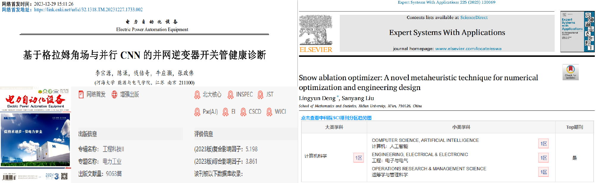
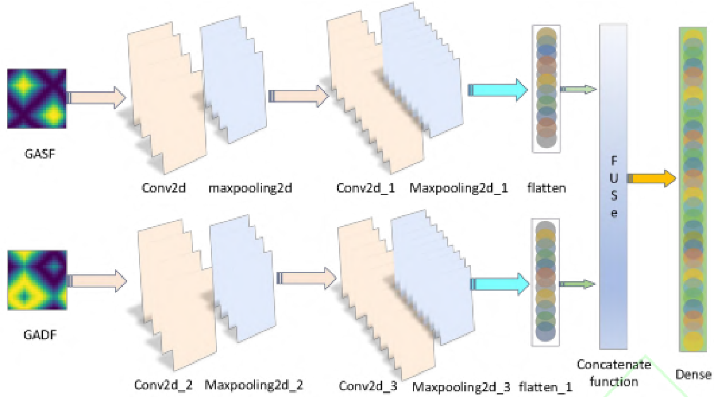
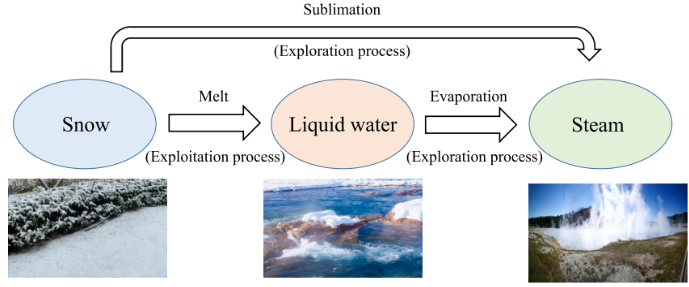
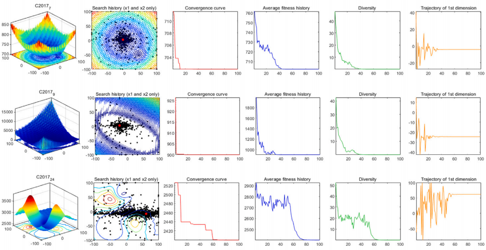
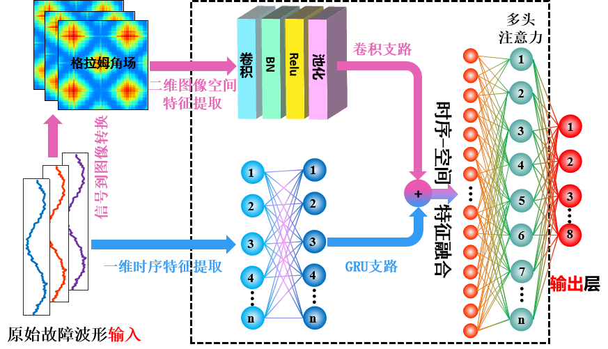
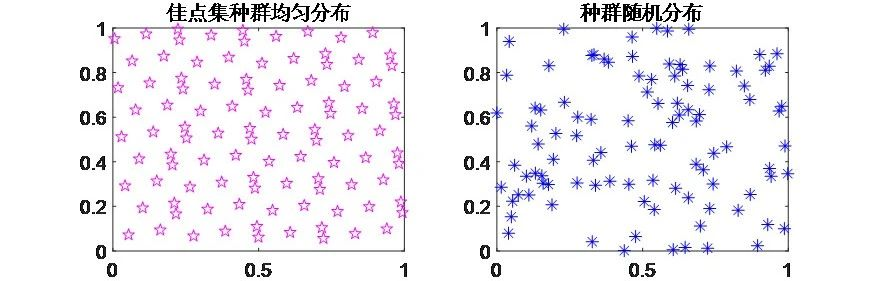
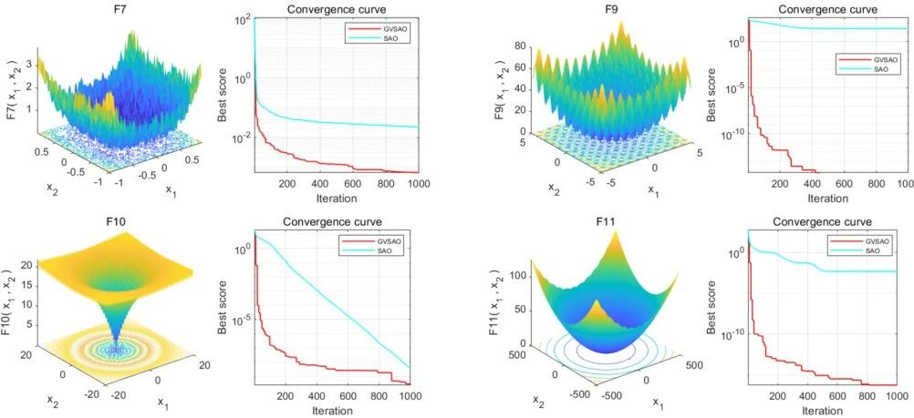
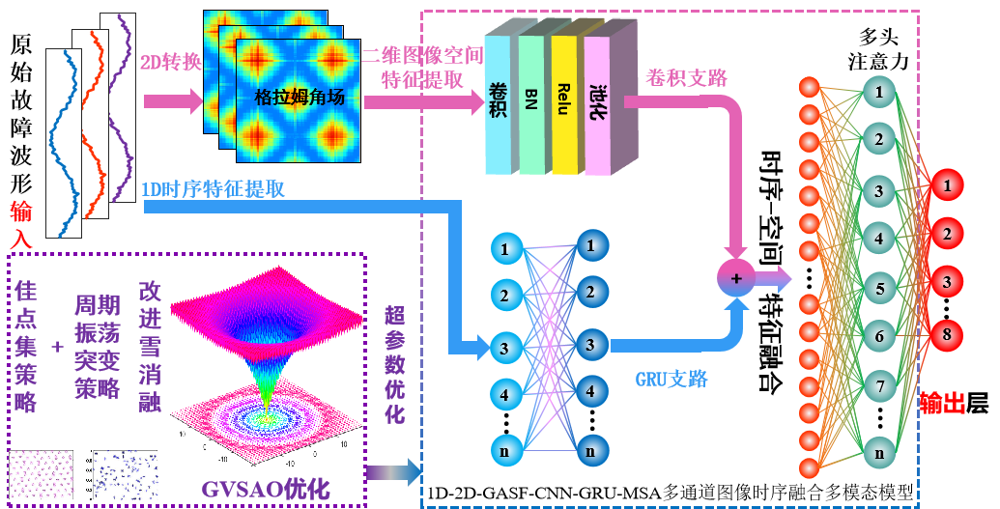
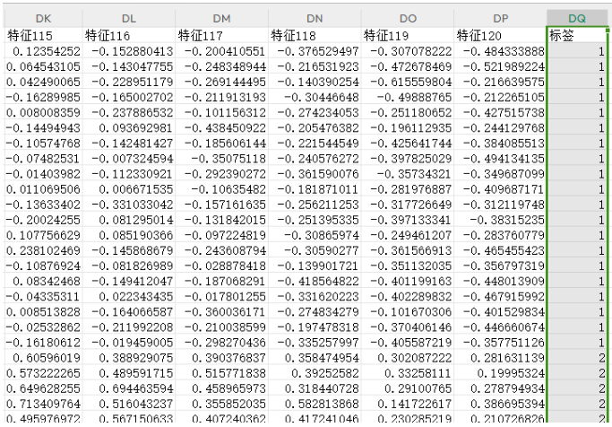
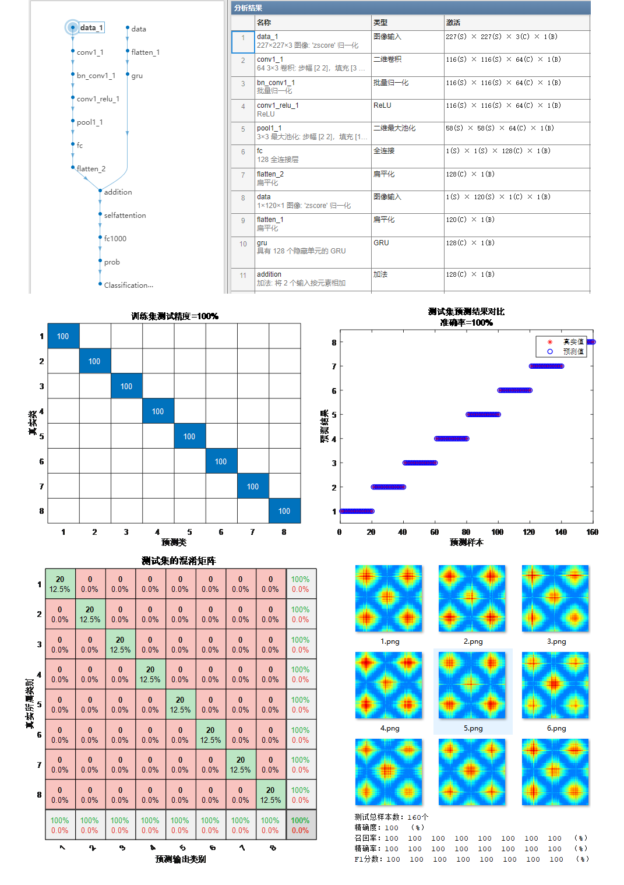
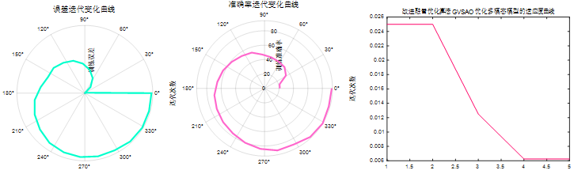

<!-- PAYMENT_BLOCK -->

## Get this dataset

- Payment link (Stripe): [Buy now](https://buy.stripe.com/3cs8yP7sY87d0vu9AB)
- Payment QR code: 

<!-- /PAYMENT_BLOCK -->
